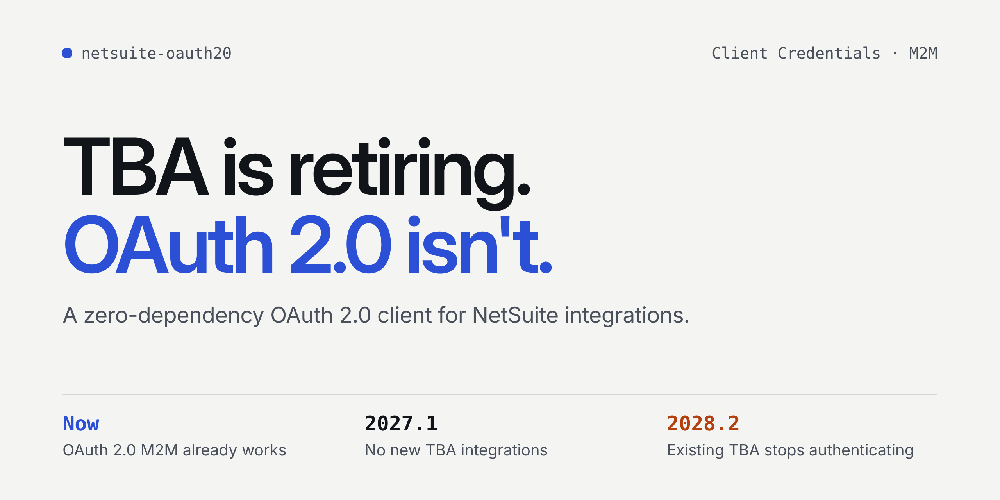
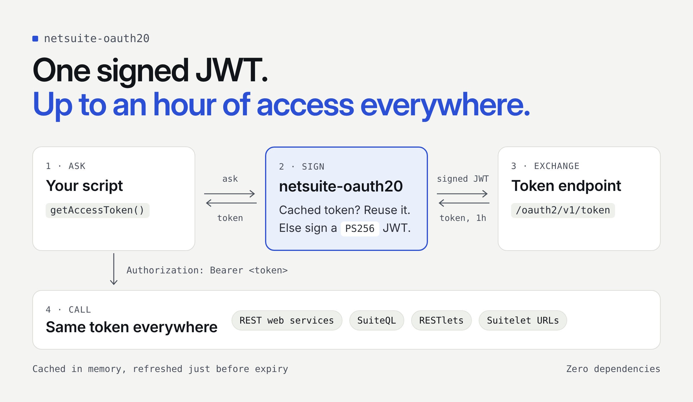

# netsuite-oauth20



A zero-dependency OAuth 2.0 **Client Credentials (Machine-to-Machine)**
client, authenticating via a JWT-bearer client assertion
([RFC 7523 §2.2](https://www.rfc-editor.org/rfc/rfc7523#section-2.2)), with a
thin NetSuite adapter on top.

## Install

```sh
npm install netsuite-oauth20
```

## Quick start

1. Create a `.env` file in your project with your four real values:

   ```
   NETSUITE_ACCOUNT_ID=1234567_SB1
   NETSUITE_CLIENT_ID=your-integration-client-id
   NETSUITE_CERTIFICATE_ID=your-certificate-id
   NETSUITE_PRIVATE_KEY_PATH=/absolute/path/to/your-private-key.pem
   ```

   Make sure `.env` is `.gitignore`d so it's never committed. (A copy of
   this template also ships inside the installed package, at
   `node_modules/netsuite-oauth20/.env.example`.) Don't have these four
   values yet? See [NetSuite setup](#netsuite-setup) below.


2. Save the snippet below as `quick-test.js` and run it with
   `node --env-file=.env quick-test.js` - Node's native `--env-file` flag
   loads `.env` into `process.env`, no `dotenv` package needed:

   ```javascript
   const fs = require('fs');
   const { createNetSuiteTokenClient, suiteQlUrlFor } = require('netsuite-oauth20/netsuite');

   async function main() {
     const client = createNetSuiteTokenClient({
       accountId: process.env.NETSUITE_ACCOUNT_ID,         // e.g. "1234567_SB1"
       clientId: process.env.NETSUITE_CLIENT_ID,           // Integration record's Client ID
       certificateId: process.env.NETSUITE_CERTIFICATE_ID, // M2M Setup record's Certificate ID
       privateKey: fs.readFileSync(process.env.NETSUITE_PRIVATE_KEY_PATH, 'utf8'),
     });

     const accessToken = await client.getAccessToken();

     const response = await fetch(suiteQlUrlFor(process.env.NETSUITE_ACCOUNT_ID), {
       method: 'POST',
       headers: {
         Authorization: `Bearer ${accessToken}`,
         'Content-Type': 'application/json',
         Prefer: 'transient',
       },
       body: JSON.stringify({ q: "SELECT Symbol, Name, ExchangeRate, DisplaySymbol, SymbolPlacement, CurrencyPrecision, IsBaseCurrency FROM Currency WHERE ( IsInactive = 'F' ) ORDER BY Symbol" }),
     });

     console.log(await response.json());
   }

   main();
   ```

## Table of contents

- [Why this package](#why-this-package)
- [NetSuite setup](#netsuite-setup)
- [NetSuite quirks](#netsuite-quirks)
- [How it works](#how-it-works)
- [API reference](#api-reference)
- [Troubleshooting](#troubleshooting)
- [Security](#security)
- [Scope: Client Credentials (M2M) only](#scope-client-credentials-m2m-only)
- [Running the smoke test from a clone](#running-the-smoke-test-from-a-clone)

## Why this package

- **Zero npm dependencies.** The entire flow - building a JWT, signing it,
  and exchanging it for an access token - only needs Node's built-in
  `crypto` module and `fetch`. Pulling in `jsonwebtoken`, `jose`, `axios`,
  or similar would mean trusting a large, general-purpose library (and its
  own transitive dependencies) for something this package can do directly
  and auditably in a few hundred lines. `dependencies` is `{}` by design.
- **Two layers.** `src/core/` is fully provider-agnostic: it implements
  the Client Credentials grant via a JWT-bearer assertion and has zero
  knowledge of NetSuite or any other authorization server - it never adds
  an `aud` or `sub` claim on its own, since many real authorization
  servers reject assertions carrying claims they don't expect.
  `src/adapters/netsuite/` is a thin layer on top that only encodes
  NetSuite-specific details (see [NetSuite quirks](#netsuite-quirks)) and
  delegates all signing/token-exchange/caching to core. This means core is
  reusable for any other JWT-bearer-style OAuth provider via a similarly
  thin adapter.
- **Proven against a real NetSuite account** - see
  [NetSuite quirks](#netsuite-quirks).

`engines.node` is `>=20.6` (the minimum for global `fetch`, PS256 signing,
and `--env-file`); this repo itself is developed against the current LTS
line (see `.nvmrc`).

## NetSuite setup

One-time, manual steps an account administrator performs in NetSuite
before this package can request tokens. Full walkthrough:
[`docs/NETSUITE_SETUP.md`](./docs/NETSUITE_SETUP.md). You'll come away
with four values:

| Value | Where it comes from |
|---|---|
| `NETSUITE_ACCOUNT_ID` | NetSuite's URL bar / Company Information, e.g. `1234567_SB1` |
| `NETSUITE_CLIENT_ID` | The Integration record (step 3) |
| `NETSUITE_CERTIFICATE_ID` | The OAuth 2.0 Client Credentials (M2M) Setup record (step 4) |
| `NETSUITE_PRIVATE_KEY_PATH` | The RSA key pair you generate yourself (step 2) - the private key never leaves the machine that uses it |

In production, fetch these from your infrastructure's secrets store at
startup (Vault, AWS/GCP/Azure Secrets Manager, Doppler, etc.) and pass the
resolved values straight into `createNetSuiteTokenClient()` - it only
takes plain JavaScript values and has no opinion on where they came from.

## NetSuite quirks

Encoded into `src/adapters/netsuite/index.js` so nobody has to
re-discover them the hard way:

- Sign with **PS256** (RSASSA-PSS), not RS256 - NetSuite rejects RS256.
- The JWT payload must **not** include an `aud` claim - confirmed to cause
  `invalid_grant`. The adapter does not expose an `audience` option.
- The JWT payload **must** include a `scope` claim naming the scope(s)
  enabled on the Integration record (e.g. `["rest_webservices"]`) - without
  it, the token endpoint returns HTTP 400 `{"error":"invalid_request"}`
  with no further detail. The adapter defaults `scope` to
  `["rest_webservices"]`; override it if your Integration record also
  enables other scopes (e.g. RESTlets).
- The assertion's `exp` must not exceed `iat + 3600` (1 hour) - the
  adapter enforces this as a hard cap via `jwtLifetimeSeconds`, but
  defaults it to `300` (5 minutes), since the assertion is single-use and
  consumed the moment it's traded for an access token; it only needs
  enough lifetime to absorb clock drift. This is separate from the
  *access token's* own lifetime (up to an hour), which NetSuite sets via
  the token response's `expires_in`.
- The JWT header's `kid` must be the NetSuite "Certificate ID".
- `iss` must be the NetSuite Integration record's "Client ID".
- Token endpoint:
  `https://<account-domain>.suitetalk.api.netsuite.com/services/rest/auth/oauth2/v1/token`,
  where `<account-domain>` is the account ID with underscores replaced by
  hyphens and lowercased (e.g. `1234567_SB1` -> `1234567-sb1`). Use
  `domainFor(accountId)` - never paste a raw account ID into a URL.
- SuiteQL endpoint:
  `https://<account-domain>.suitetalk.api.netsuite.com/services/rest/query/v1/suiteql`.
- A bearer token obtained this way has been confirmed to work not just for
  REST Web Services but also RESTlets and a Suitelet's external URL
  (`scriptlet.nl`) - the same `Authorization: Bearer <token>` header works
  everywhere, with no per-endpoint-type special-casing needed. (The
  bundled example only exercises SuiteQL.)

## How it works

Where each layer sits between your application and NetSuite:



> **ELI5:** Instead of a password, your app signs a short-lived note with a
> private key and hands it to NetSuite, which trades it for a temporary
> pass (access token) good for up to an hour. That pass works at every
> NetSuite door - SuiteQL, RESTlets, Suitelets - and the package keeps it
> in memory, only asking for a new one once it's about to expire.
> Concurrent requests made while a refresh is already in flight share that
> one request instead of each asking separately.

## API reference

### `createNetSuiteTokenClient(options)` - `require('netsuite-oauth20/netsuite')`

| Option | Required | Default | Description |
|---|---|---|---|
| `accountId` | yes | - | NetSuite account ID, e.g. `"1234567_SB1"` |
| `clientId` | yes | - | Integration record's Client ID (JWT `iss`) |
| `certificateId` | yes | - | M2M Setup record's Certificate ID (JWT header `kid`) |
| `privateKey` | yes | - | PEM-encoded RSA private key matching the uploaded certificate |
| `subject` | no | *(unset)* | JWT `sub` claim |
| `scope` | no | `["rest_webservices"]` | JWT payload `scope` claim (string or array) - the scope(s) enabled on the Integration record |
| `extraClaims` | no | *(unset)* | Merged into the JWT payload as-is |
| `jwtLifetimeSeconds` | no | `300` | Assertion lifetime; `exp = iat + this`. Hard-capped at `3600` by NetSuite |
| `clockSkewSeconds` | no | `60` | Refresh the cached access token this many seconds before actual expiry |
| `fetch` | no | global `fetch` | Inject a custom fetch implementation (e.g. for tests) |
| `now` | no | `() => Date.now()` | Inject a custom clock (e.g. for tests) |

Returns `{ getAccessToken(): Promise<string>, clearCache(): void }`.

### `createTokenClient(options)` - `require('netsuite-oauth20')`

The generic core underneath the NetSuite adapter - usable directly against
any JWT-bearer-style OAuth 2.0 authorization server.

| Option | Required | Default | Description |
|---|---|---|---|
| `tokenUrl` | yes | - | OAuth 2.0 token endpoint URL |
| `algorithm` | yes | - | `RS256`, `RS384`, `RS512`, `PS256`, `PS384`, or `PS512` |
| `privateKey` | yes | - | PEM-encoded RSA private key |
| `issuer` | yes, unless `buildClaims` is set | - | JWT `iss` claim |
| `header` | no | *(unset)* | Merged into the JWT header alongside `typ`/`alg` (e.g. `{ kid }`) |
| `subject` | no | *(unset)* | JWT `sub` claim |
| `audience` | no | *(unset)* | JWT `aud` claim - never added unless set |
| `extraClaims` | no | *(unset)* | Merged into the JWT payload as-is |
| `buildClaims` | no | *(unset)* | `({ issuer, nowSeconds }) => payload` - replaces default claim-building entirely |
| `scope` | no | *(unset)* | Sent as the **token request's** `scope` form parameter (not a JWT claim - contrast with the adapter's `scope`, which NetSuite requires as a payload claim instead) |
| `jwtLifetimeSeconds` | no | `300` | `exp = iat + this` |
| `clockSkewSeconds` | no | `60` | Refresh this many seconds before actual expiry |
| `fetch` | no | global `fetch` | Inject a custom fetch implementation |
| `now` | no | `() => Date.now()` | Inject a custom clock |

Returns `{ getAccessToken(): Promise<string>, clearCache(): void }`.
Concurrent `getAccessToken()` calls made while a refresh is already in
flight share that single in-flight request rather than each firing their
own.

### Other NetSuite adapter exports

- `domainFor(accountId)` - converts an account ID to its API domain form.
- `tokenUrlFor(accountId)` / `suiteQlUrlFor(accountId)` - build the
  account-specific token/SuiteQL endpoint URLs.

## Troubleshooting

Common failure points when running against a real account, roughly in the
order to check them:

- **`ENOENT` reading the private key** - `NETSUITE_PRIVATE_KEY_PATH` is
  wrong, relative, or points at the public certificate instead of the
  private key.
- **Token request fails with `HTTP 400: invalid_request`** - the JWT
  payload is missing (or has a wrong) `scope` claim. The adapter defaults
  `scope` to `["rest_webservices"]`; if your Integration record's enabled
  scope differs, pass the matching value explicitly (see
  [NetSuite quirks](#netsuite-quirks) above). This is the most common
  first-run failure and is easy to mistake for a credentials problem since
  NetSuite's error body gives no further detail.
- **Token request fails with `HTTP 400: invalid_grant`** - usually a
  Client ID/Certificate ID/private key mismatch (they must all come from
  the same Integration + M2M Setup record pairing), or a large clock skew
  between your machine and NetSuite.
- **SuiteQL request fails with `HTTP 401/403`** even though the token
  request succeeded - check, in order:
  - The **REST Web Services** feature isn't enabled (Setup > Company >
    Enable Features > SuiteCloud) - see
    [`docs/NETSUITE_SETUP.md`](./docs/NETSUITE_SETUP.md) step 1.
  - The Role doesn't have the **Log in using OAuth 2.0 Access Tokens**
    permission - see step 4.
  - The Role lacks permission for the specific record type/fields in your
    query (e.g. querying `employee` needs more than base REST Web
    Services access in some role configurations).
- **Everything passes but returns 0 rows** - likely just an empty result
  for that query/account, not a configuration problem; try a known-good
  query like `SELECT 1 AS ok FROM dual` to isolate token/permission issues
  from query-specific ones.

## Security

- **Never commit secrets.** `.gitignore` already excludes `.env`, `*.pem`,
  `*.key`, `*.crt`, `*.p12`, `*.pfx`, and `.certs/` - keep your private key
  and `.env` file out of version control and CI logs.
- **The private key is the real secret.** The account ID, Client ID, and
  Certificate ID aren't by themselves enough to get a token (NetSuite still
  requires a valid signature from the private key), but avoid putting any
  of the four values in logs, error messages, or shared chat - combined
  with a leaked key, they're exactly what's needed to request tokens as you.
- **In production, use a secrets manager, not a `.env` file.** Fetch the
  private key and IDs from your infrastructure's secrets store at startup
  rather than shipping a `.env` file to a server or container image.
- **Tokens are cached in memory only.** Neither `createTokenClient()` nor
  `createNetSuiteTokenClient()` ever writes the access token to disk; it
  exists only as long as the process does.
- **If a private key is ever exposed**, revoke it right away: replace the
  Certificate on the OAuth 2.0 Client Credentials (M2M) Setup record in
  NetSuite (see `docs/NETSUITE_SETUP.md`), generate a new key pair, and
  update it wherever the old key was stored. NetSuite has no way to detect
  on its own that a key was compromised - a leaked key stays usable until
  someone revokes it.
- **Reporting a vulnerability in this code**: see
  [`SECURITY.md`](./SECURITY.md) for how to report it privately rather
  than filing a public issue with exploit details.

## Scope: Client Credentials (M2M) only

This package implements the Client Credentials / JWT-bearer grant only. It
does not implement the Authorization Code grant (browser consent + refresh
tokens) - that would be a separate module built on the same `src/core/`
primitives (JWT signing, token caching), not bolted onto this one.

## Running the smoke test from a clone

For contributors and evaluators - the fastest path from a clone to a
passing, real-account test:

1. **Prerequisites**: Node >= 20.6 (see `.nvmrc` for the version this repo
   is developed against).
2. **Install dependencies**: `npm install` (no runtime dependencies to
   fetch, but this sets up the project).
3. **One-time NetSuite admin setup**: follow
   [NetSuite setup](#netsuite-setup) above.
4. **Configure credentials** - copy the template and fill in your real
   values (`.env` is already `.gitignore`d, so it's never committed):
   ```sh
   cp .env.example .env
   # edit .env: NETSUITE_ACCOUNT_ID, NETSUITE_CLIENT_ID,
   # NETSUITE_CERTIFICATE_ID, NETSUITE_PRIVATE_KEY_PATH
   ```
5. **Run the example**:
   ```sh
   npm run example:netsuite:dotenv
   ```
   (Alternatively, `export` the four variables yourself and run
   `npm run example:netsuite` instead.)

   Expected output on success:
   ```
   [PASS] Token obtained via Client Credentials (M2M/JWT)
   [PASS] SuiteQL query succeeded (N row(s)):
   [ ... ]
   ```
   A `[FAIL]` line means something's misconfigured - see
   [Troubleshooting](#troubleshooting) above. The bundled query in
   `examples/netsuite-suiteql-smoke-test.js` is a convenience example, not
   a fixed contract - edit the `q` value to run any other read-only
   SuiteQL query against your account.
6. **Run the test suite**: `npm test` (runs `node --test test/`, no
   network access or real credentials required).
